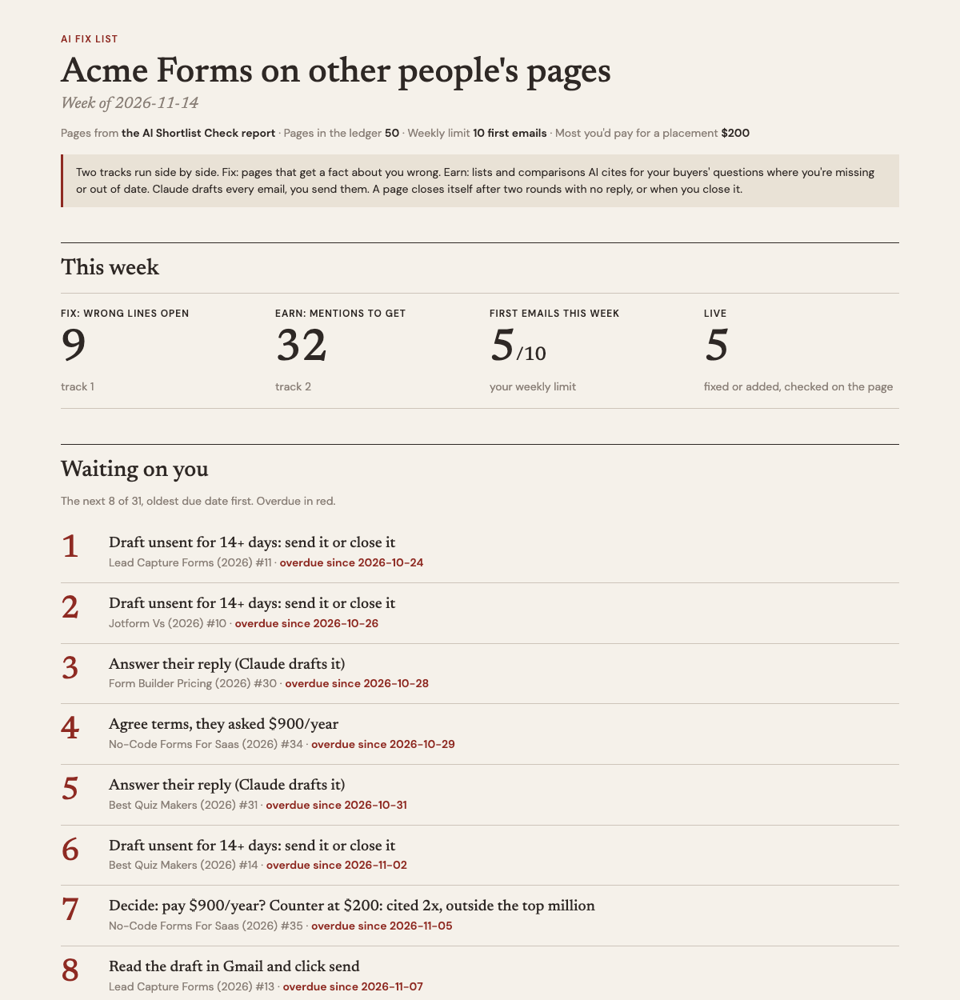
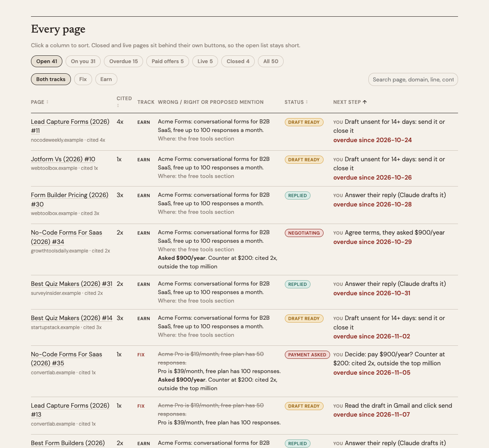

# AI Fix List

Most of what ChatGPT says about your SaaS comes from pages you don't own. Other people's best X lists, a competitor's pricing post, a review site, a Reddit thread. This skill works those pages for you every week, on two tracks at once:

- **Fix:** pages that get a fact about you wrong (a price, a plan limit, a feature they say you don't have)
- **Earn:** lists and comparisons AI cites for your buyers' questions where you're missing or out of date

It drafts every email. You send them. It never emails anyone on its own and never agrees to pay for a spot.



*The top of the report, on made-up data for a made-up form builder.*

## How it works

It sits on top of the [AI Shortlist Check](../../../ai-shortlist-check/skills/ai-shortlist-check/README.md), which asks ChatGPT, Gemini and Google your buyers' questions every week and keeps every link they cite. The Fix List opens those pages and does the outreach.

1. **Setup, once.** Six questions, one at a time: your pricing and positioning pages (it writes down every fact and every feature, the core ones marked), two sentences a list owner should say about you, your Gmail, what you can offer an owner, the most you'd pay for a placement and how many new emails a week you can actually send (5, 10, 20 or 30).
2. **Every week.** It checks your own pages for changes first (change your pricing and it rechecks everything). Then the inbox and the follow-ups that are due. Then the new pages from your latest Shortlist Check run: it filters out vendors' own pages, content farms and lists for a buyer you don't serve, finds who owns each page (never guesses an email) and checks your history with them.
3. **The emails.** Fix emails name one wrong line, the right line and the proof. Earn emails send the exact entry in the owner's format, say where it would go and why it helps their readers. The first email lands in your Gmail drafts with 3 follow-ups written at the same time (day 7, 14 and 28).
4. **The report.** One HTML file next to your Shortlist Check report, same look. Every page with its stage in colour, the next step, who it's on and by when, overdue in red. Sort it, filter it, search it.

   

Nothing stays open forever. Two rounds with no reply and a page closes itself. A draft you never sent or a page stuck behind your weekly limit comes back as "send it or close it". Every close carries a reason, so you can still find it when an owner writes back a year later.

When an owner asks for money, it prices the spot for you: how often AI actually cites that page first, the domain's authority second, against the ceiling you set. You still say yes or no.

## What it costs

Nothing on top of the AI Shortlist Check. No API keys of its own. It fetches the pages itself and uses the free [Tranco list](https://tranco-list.eu) for domain authority. The only cost is the Claude session that reads the pages and writes the drafts.

## Install

It needs the [AI Shortlist Check](../../../ai-shortlist-check/skills/ai-shortlist-check/README.md) set up first. It also needs a setup that can run Python and reach the web.

**Claude Code**

```
/plugin marketplace add pogonow/operator-toolkit
/plugin install ai-fix-list@operator-toolkit
```

**Cowork on your computer:** download [the ZIP](https://github.com/pogonow/operator-toolkit/raw/main/downloads/Anti_Grind_SaaS_Manual_AI_Fix_List.zip) and upload it under Skills in Claude's settings.

Plain claude.ai chat won't do here, since it can't run the script or keep the ledger between weeks.

Then say "Run AI Fix List for [your product]". After the first run it offers to set up the weekly run for you.

## Read the why

Why most of your AI answer comes from other people's pages and what to write to them is in [The Anti-Grind SaaS Manual](https://owneropsguide.substack.com).

## Something broke?

Open an [issue](https://github.com/pogonow/operator-toolkit/issues) or DM me on [LinkedIn](https://www.linkedin.com/in/pawelogonowski/). If a page got marked wrong when it wasn't, send me the line and your pricing page.
