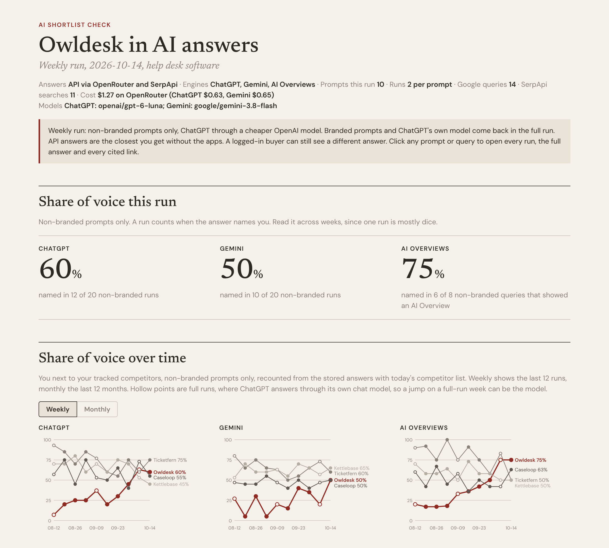
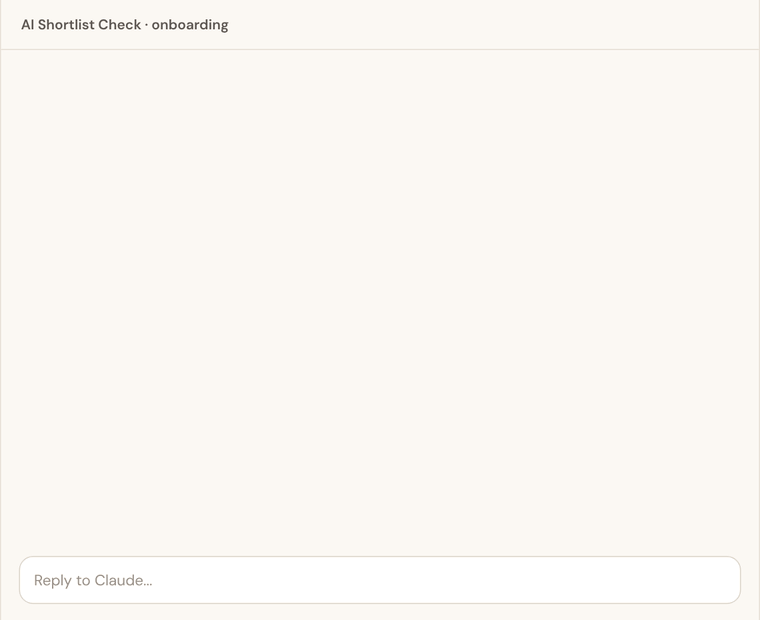
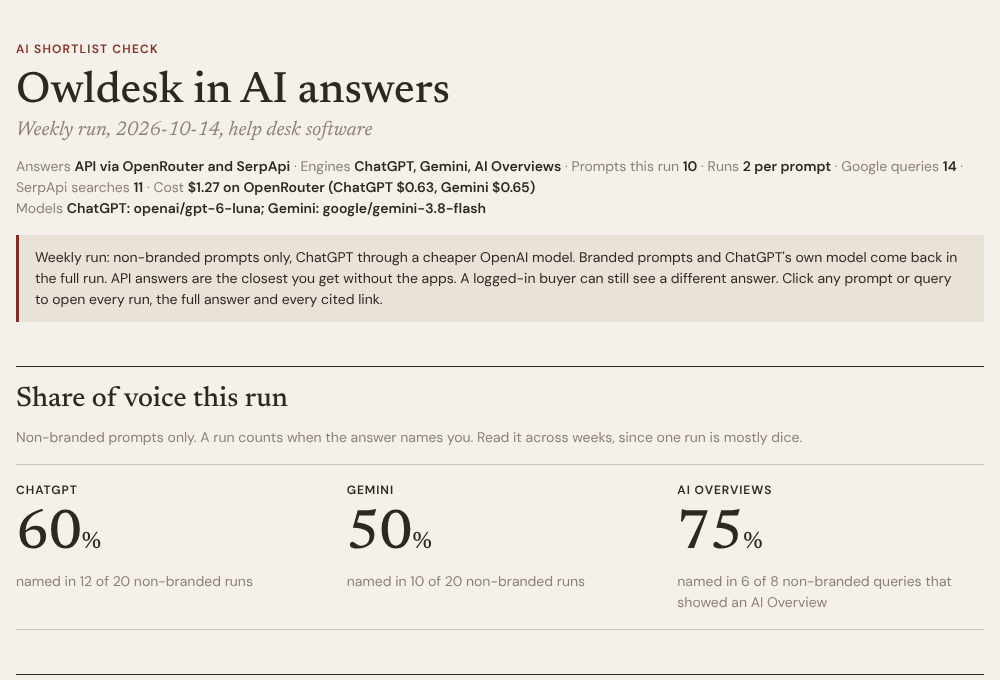

# AI Shortlist Check

Does ChatGPT recommend your SaaS or someone else? This skill checks every week, for about $7 to $19 a month in API costs.

Typing "best [your category]" into ChatGPT once tells you almost nothing, because AI tools repeat the same list of brands less than once in 100 runs ([SparkToro](https://sparktoro.com/blog/new-research-ais-are-highly-inconsistent-when-recommending-brands-or-products-marketers-should-take-care-when-tracking-ai-visibility/)). What you need is the same buyer prompts every week, each run more than once, and a record of who got named when you didn't. That's what this does.



*The top of the report, on made-up data for a made-up help desk SaaS.*

## How it works

1. **Onboarding, once.** Ten questions, one at a time, about 20 minutes: your product and pricing page, the niches you can win, three competitors, your buyer prompts (written the way buyers talk to ChatGPT) and a list of short Google searches for AI Overviews. Three of the questions set your monthly cost, with the number next to every option.

   

2. **Every week.** It asks ChatGPT and Gemini with web search on (one OpenRouter key) and checks Google's AI Overviews (SerpApi, free plan). Weekly runs use a cheaper OpenAI model. Every four or eight weeks a full run asks everything through ChatGPT's own model and checks the cheap one against it.
3. **What you get back.** Share of voice per engine next to your competitors, the brands named instead (the ones you don't track too), the exact pages cited when you're missing, up to five fixes for the week (the ones you control first) and flags for answers that quote a wrong price.
4. **The report.** One HTML file that grows week by week: trends (weekly or monthly), every prompt opened run by run with the full answer and clickable sources, every AI Overview.

   

It never gives you a "rank" from one run, never passes off its own web search as ChatGPT's answer and never publishes anything.

## What it costs

Measured on real calls, details in [`references/costs.md`](references/costs.md). With 2 weekly runs and a full run every 4 weeks: 10 prompts about $7 a month, 15 about $11, 20 about $15, 25 about $19. AI Overviews fit SerpApi's free plan. Put at least $15 on OpenRouter to start. The script prints the real cost after every run.

## Install

**Claude Code**

```
/plugin marketplace add pogonow/operator-toolkit
/plugin install ai-shortlist-check@operator-toolkit
```

**Claude.ai and Cowork:** download [the ZIP](https://github.com/pogonow/operator-toolkit/raw/main/downloads/Anti_Grind_SaaS_Manual_AI_Shortlist_Check.zip) and upload it under Skills in Claude's settings. The fully automatic API route needs a setup that can run the scripts with your keys (Claude Code or Cowork on your computer). Without keys it still runs, with Claude's own web search marked as an approximation plus a few answers you paste each week.

Then say "Run AI Shortlist Check for [your product]".

## Read the why

The research behind every rule (what gets a SaaS cited and what doesn't) is in [The Anti-Grind SaaS Manual](https://owneropsguide.substack.com).

## Something broke?

Open an [issue](https://github.com/pogonow/operator-toolkit/issues) or DM me on [LinkedIn](https://www.linkedin.com/in/pawelogonowski/). If your first run costs a lot more than the table, tell me what the script printed.
